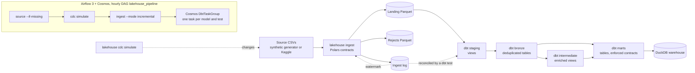

# de-lakehouse-pipeline

An end-to-end ELT pipeline on open e-commerce data: Polars ingestion with typed data contracts, then a dbt staging, bronze, intermediate and marts build on DuckDB, reproducible with one command and no credentials.

[](https://github.com/emanuel-luis/de-lakehouse-pipeline/actions/workflows/ci.yml)


## What this demonstrates

- Typed data contracts at the landing boundary: every source table has a schema, bad rows are split out with a reason instead of failing the load or slipping through, and a table whose reject ratio is too high fails loudly.
- Idempotent, atomic, re-runnable steps: files are written to a temp path and swapped in with `os.replace`, and re-running the pipeline gives identical data.
- Run metadata: each run records a run_id, UTC timestamps, row counts and rejects per table in an ingest log, and a dbt test reconciles the landing data against that log.
- A four-layer dbt build on DuckDB (staging, bronze, intermediate, marts) over all nine Olist tables: deduplicated bronze tables, enriched views, star-schema marts with enforced model contracts, a description on every mart column, and tests on keys, ranges and relationships.
- Change data capture on a source with no update column: a simulator changes the source, the ingest lands only the rows past a watermark kept in the ingest log, and `bronze_orders` merges them incrementally.
- Orchestration with Airflow 3 and Astronomer Cosmos: an hourly DAG runs source, CDC simulation and incremental ingest, then every dbt model and test as its own Airflow task, in a local docker compose stack. A one-slot pool serializes the tasks against DuckDB's single writer.
- One-command reproducible demo, plus CI that runs lint, tests, the full pipeline, the CDC demo and the DAG integrity test with no credentials.

## Architecture



Python owns source to landing and never writes DuckDB. dbt is the only DuckDB writer: its sources read the landing Parquet directly, so there is one writer and no lock contention. The Airflow DAG runs the same commands in order (see Orchestration); it adds scheduling and per-task visibility, not new logic.

| Layer | Location | Format | Owner | Contract and checks |
| --- | --- | --- | --- | --- |
| Source | `data/source/*.csv` | CSV | generator or Kaggle download | Olist file and column names |
| Landing | `data/landing/<table>/` | Parquet | `lakehouse ingest` | Typed contract per table, required columns, `_batch_id`, `_extracted_at`, `_source_file`; `full.parquet` plus one `batch-<run_id>.parquet` per incremental orders load |
| Rejects | `data/rejects/<table>/` | Parquet | `lakehouse ingest` | Source columns as text plus `_reject_reason` and `_batch_id` |
| Ingest log | `data/_meta/ingest_log/` | Parquet | `lakehouse ingest` | One row per table and run; reconciled with landing by a dbt test |
| Staging | schema `staging` | DuckDB views | dbt | Renames and cleaning only, one model per landing table; not_null, accepted_values and ranges (keys are tested in bronze, since landing keeps duplicates) |
| Bronze | schema `bronze` | DuckDB tables | dbt | One deterministic row per natural key (latest `_batch_id` wins); `bronze_orders` is incremental; geolocation collapsed to one row per zip prefix; unique, not_null, relationships |
| Intermediate | schema `intermediate` | DuckDB views | dbt | Joins and the translated product category, at a declared grain; grain tests |
| Marts | schema `marts` | DuckDB tables | dbt | Star schema with enforced contracts, column descriptions, key, range and relationship tests |

### Marts

| Model | Grain |
| --- | --- |
| `fct_orders` | one row per order |
| `fct_order_items` | one row per order line (order, item number) |
| `dim_customers` | one row per `customer_unique_id` |
| `dim_products` | one row per product, with orders, revenue and average review score |
| `dim_sellers` | one row per seller, with orders, items sold, revenue and average review score |
| `dim_dates` | one row per calendar day between the first and last order date |

Both facts carry foreign keys to the dimensions, checked by relationship tests. Products with no category, or a category missing from the translation table, get the category `unknown`.

## Quickstart

Prerequisites: [uv](https://docs.astral.sh/uv/), `make` and bash (Linux, macOS, or WSL on Windows).

```bash
git clone https://github.com/emanuel-luis/de-lakehouse-pipeline && cd de-lakehouse-pipeline
make demo
```

`make demo` writes synthetic source CSVs, ingests them into landing Parquet, installs the dbt packages, runs `dbt build` (models and tests), and prints the last ingest run with the mart row counts. Everything lands under `data/` (gitignored); the warehouse is `data/warehouse/lakehouse.duckdb`.

Query the marts with a read-only connection (dbt holds the write lock while it runs):

```bash
duckdb -readonly data/warehouse/lakehouse.duckdb "select order_status, count(*) from marts.fct_orders group by 1"
# or, without the DuckDB CLI:
uv run python -c "import duckdb; c = duckdb.connect('data/warehouse/lakehouse.duckdb', read_only=True); print(c.sql('select * from marts.dim_customers limit 5'))"
```

### Real data

```bash
cp .env.example .env        # then uncomment and set DATA_SOURCE=kaggle and KAGGLE_API_TOKEN
make demo
```

Values in `.env` take precedence over shell variables for `make` targets. For a one-off run, pass the variable on the command line instead: `make demo DATA_SOURCE=kaggle` (with `KAGGLE_API_TOKEN` exported).

The [Olist Brazilian e-commerce dataset](https://www.kaggle.com/datasets/olistbr/brazilian-ecommerce) is downloaded at runtime from Kaggle under its own license (CC BY-NC-SA 4.0 per the Kaggle page). It is never committed to this repository. The MIT license covers the code only.

The default synthetic data has the same file and column names and referential integrity, from a fixed seed, with deliberate dirt: duplicated and jittered geolocation rows, orders without items, junk rows with a null key, non-numeric prices, repeated review ids, products without a category or missing from the translation table, mixed-case cities with trailing spaces, and zip prefixes without zero padding.

## Run metadata and idempotency

- run_id has the form `YYYYMMDDTHHMMSSffffffZ` (UTC, sorts lexically) and doubles as the `_batch_id` stamped on every landed row.
- The ingest log has one row per table and run: `run_id, data_source, table_name, mode, status, started_at, finished_at, rows_in, rows_out, rows_rejected, watermark_column, watermark_from, watermark_to, landing_file, error`. The invariant is `rows_in = rows_out + rows_rejected`.
- Landing and reject files are written to a temp file in the same directory and swapped in with `os.replace`, so a failed write never leaves a partial file.
- Commit order: the landing file first, the log row after. A crash in between leaves data without a log row, never a log row without data.
- Re-running ingestion replaces the landing files with the same content, so a second `make demo` gives identical data. The dbt test `reconciles_with_ingest_log` fails the build if landing and log disagree.

## Change data capture

Olist has no update column, so landing derives `order_updated_at` as the latest lifecycle timestamp of an order, and that is the watermark column.

```bash
make cdc-demo
```

`make cdc-demo` runs `make demo`, then:

1. `lakehouse cdc simulate` changes the source CSVs in place. Up to 50 orders that have items move one lifecycle step (created to approved, approved, invoiced or processing to shipped, shipped to delivered), each setting exactly the matching timestamp, and 20 new `created` orders arrive with a new customer, 1 to 3 items on existing products and sellers, and one credit card payment for the total. The simulated clock is one hour after the latest lifecycle timestamp in the data, never the wall clock, so the same source and seed always give the same files. Options: `--changes`, `--new-orders`, `--seed`.
2. `lakehouse ingest --mode incremental` reads the last watermark of `orders` from the ingest log (the highest `watermark_to` since the latest successful full load) and lands only the rows whose `order_updated_at` is later, or cannot be computed so validation still sees them, as `batch-<run_id>.parquet`. The log row records `watermark_from` and `watermark_to`. Without a previous watermark the table is loaded in full; the other tables have no watermark column and are always reloaded in full.
3. `dbt build` merges the new batch into `bronze_orders` (`delete+insert` on `order_id`, only batches newer than the table). When the ingest log shows a full load of orders newer than the table, the table is emptied first and rebuilt from landing, so a regenerated source never leaves stale orders behind.
4. `lakehouse summary --watermarks` shows the run, the current watermark and the mart counts: `fct_orders` gains exactly the new orders.
5. A second incremental ingest finds no rows past the watermark: it writes no file, keeps the watermark and logs a successful run with 0 rows. The next `dbt build` leaves the marts unchanged.

Known limits of this design:

- No hard deletes: a row removed from the source is never removed downstream.
- A change that sets no lifecycle timestamp (for example a status fix with no new date) does not move `order_updated_at` and is not captured.
- The strict `>` comparison assumes the source clock never goes backwards; a late write stamped at or before the watermark is missed.

## Orchestration

Airflow 3.3.2 runs the pipeline on an hourly schedule, with dbt orchestrated by [Astronomer Cosmos](https://astronomer.github.io/astronomer-cosmos/) 1.15.1. Prerequisite: Docker with compose.

```bash
make up      # builds the image, creates the secrets in .env, starts the stack
```

The UI is at http://localhost:8080. It uses Airflow's simple auth manager with every user as admin and no login: local use only, never expose it. `make up` appends a JWT secret and a Fernet key to the gitignored `.env` when they are missing and never prints them.

The DAG `lakehouse_pipeline` (`@hourly`, one active run at a time, no catchup) runs, in order:

1. `lakehouse source --if-missing`: writes the synthetic source only when it does not exist yet.
2. `lakehouse cdc simulate`: changes the source.
3. `lakehouse ingest --mode incremental`: lands the rows past the watermark.
4. A Cosmos task group built from the dbt manifest: one Airflow task per model and per test.

Like any Airflow DAG, it starts paused. Unpause it in the UI, trigger a run there, or use the CLI:

```bash
docker compose exec scheduler airflow dags unpause lakehouse_pipeline
docker compose exec scheduler airflow dags trigger lakehouse_pipeline
```

Every Cosmos task, models and tests alike, runs its own dbt process, and each one opens DuckDB for writing. DuckDB allows one writer, so the stack creates a pool named `duckdb_writer` with 1 slot and every Cosmos task uses it. The three bash tasks need no pool because Python never writes DuckDB.

The DAG, the dbt project, the manifest (written by `dbt parse` at build time) and the pipeline virtualenv are baked into the image; there are no bind mounts, so a DAG edit needs another `make up`, which rebuilds the image. Warehouse and landing data live in the named volume `lakehouse-data`.

```bash
make dag-test   # DAG integrity test: dbt parse, then DagBag import checks in a throwaway Airflow + Cosmos venv
make down       # stops the stack and deletes its volumes, including the warehouse
```

## Tech stack

Python 3.12 · Polars · Pydantic · DuckDB · dbt-core 1.12 · dbt-duckdb · dbt_utils · Airflow 3.3 · Astronomer Cosmos · Docker Compose · uv · ruff · mypy · pytest · Hypothesis · GitHub Actions

## Project structure

```
src/de_lakehouse_pipeline/   ingestion: settings, contracts, sources, landing, run log, CLI
dbt/                         dbt project: staging, bronze, intermediate, marts, generic and singular tests, profiles
tests/                       pytest suite (hermetic: each test runs in its own temp dir)
airflow/                     Dockerfile, the lakehouse_pipeline DAG and its integrity test
docker-compose.yml          local Airflow stack: Postgres, scheduler, API server, DAG processor
docs/                        implementation plan and decision log
.github/workflows/           ci.yml, compose.yml, security.yml
Makefile                     single entry point for local runs and CI
```

## Development

| Target | What it does |
| --- | --- |
| `make help` | list the targets |
| `make install` | create the virtualenv from uv.lock |
| `make lint` | ruff check, ruff format --check, mypy (what the CI lint job runs) |
| `make fmt` | format and auto-fix |
| `make test-fast` | default test selection (no dbt runs) with the coverage gate |
| `make test` | every test, including the `slow` end-to-end CDC test that runs dbt (needs `make dbt-deps`) |
| `make source` | write the source CSVs (`DATA_SOURCE=synthetic` or `kaggle`) |
| `make ingest` | validate source CSVs into typed landing Parquet plus the ingest log |
| `make dbt-deps` | install dbt packages from package-lock.yml |
| `make dbt-build` | build and test every dbt model |
| `make summary` | print the last ingest run and mart row counts |
| `make demo` | source, ingest, dbt-deps, dbt-build, summary |
| `make cdc-demo` | demo, then simulate source changes, ingest incrementally, build, and repeat with an empty increment |
| `make up` | start the Airflow stack (creates missing secrets in `.env`) |
| `make down` | stop the stack and delete its volumes |
| `make airflow-manifest` | dbt deps and parse: writes `dbt/target/manifest.json` for the DAG |
| `make dag-test` | DAG integrity test in a throwaway Airflow 3.3.2 + Cosmos venv |
| `make clean` | delete generated data and dbt build output |

CI runs four jobs: lint (ruff and mypy, strict on `src`), test (pytest with an 80% coverage gate), pipeline (`make demo`, `make cdc-demo` and the slow end-to-end test on synthetic data), and dags (`make dag-test`). A separate compose workflow builds the image, starts the stack, checks that the DAG has no import errors and runs `airflow dags test lakehouse_pipeline`; on pull requests it runs only when `airflow/`, `dbt/`, `src/`, `uv.lock` or the compose file change, and it also runs on pushes to main, weekly and on demand. Configuration is documented in `.env.example`.

## Roadmap

This repository ships in stacked pull requests, one per phase. The first four are implemented.

- PR1, minimum shippable: ingestion with contracts, dbt staging and marts, tests, CI, `make demo`.
- PR2, full medallion: staging, bronze, intermediate and marts for all nine tables.
- PR3, CDC simulation: an incremental load driven by a watermark in the ingest log, and an incremental `bronze_orders`.
- PR4, orchestration: Airflow 3 and Astronomer Cosmos in a docker compose stack, with the DAG integrity test and a compose smoke workflow. This is what you are reading.
- PR5, upcoming: Elementary observability and a static docs site.

Design details: [docs/IMPLEMENTATION_PLAN.md](docs/IMPLEMENTATION_PLAN.md). Decision log: [docs/DECISIONS.md](docs/DECISIONS.md).

## License

MIT. See [LICENSE](LICENSE).
