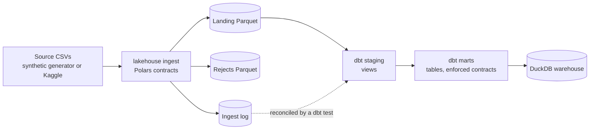

# de-lakehouse-pipeline

An end-to-end ELT pipeline on open e-commerce data: Polars ingestion with typed data contracts, then a dbt staging-to-marts build on DuckDB, reproducible with one command and no credentials.

[](https://github.com/emanuel-luis/de-lakehouse-pipeline/actions/workflows/ci.yml)


## What this demonstrates

- Typed data contracts at the landing boundary: every source table has a schema, bad rows are split out with a reason instead of failing the load or slipping through, and a table whose reject ratio is too high fails loudly.
- Idempotent, atomic, re-runnable steps: files are written to a temp path and swapped in with `os.replace`, and re-running the pipeline gives identical data.
- Run metadata: each run records a run_id, UTC timestamps, row counts and rejects per table in an ingest log, and a dbt test reconciles the landing data against that log.
- dbt staging to marts on DuckDB with enforced model contracts, a description on every mart column, and tests on keys, ranges and relationships.
- One-command reproducible demo, plus CI that runs lint, tests and the full pipeline with no credentials.

## Architecture



Python owns source to landing and never writes DuckDB. dbt is the only DuckDB writer: its sources read the landing Parquet directly, so there is one writer and no lock contention.

| Layer | Location | Format | Owner | Contract and checks |
| --- | --- | --- | --- | --- |
| Source | `data/source/*.csv` | CSV | generator or Kaggle download | Olist file and column names |
| Landing | `data/landing/<table>/` | Parquet | `lakehouse ingest` | Typed contract per table, required columns, `_batch_id`, `_extracted_at`, `_source_file` |
| Rejects | `data/rejects/<table>/` | Parquet | `lakehouse ingest` | Source columns as text plus `_reject_reason` and `_batch_id` |
| Ingest log | `data/_meta/ingest_log/` | Parquet | `lakehouse ingest` | One row per table and run; reconciled with landing by a dbt test |
| Staging | schema `staging` | DuckDB views | dbt | Renames and cleaning only; unique, not_null, accepted_values, relationships |
| Marts | schema `marts` | DuckDB tables | dbt | `fct_orders`, `dim_customers`; enforced contracts, column descriptions, key and range tests |

## Quickstart

Prerequisites: [uv](https://docs.astral.sh/uv/), `make` and bash (Linux, macOS, or WSL on Windows).

```bash
git clone https://github.com/emanuel-luis/de-lakehouse-pipeline && cd de-lakehouse-pipeline
make demo
```

`make demo` writes synthetic source CSVs, ingests them into landing Parquet, installs the dbt packages, runs `dbt build` (models and tests), and prints the last ingest run with the mart row counts. Everything lands under `data/` (gitignored); the warehouse is `data/warehouse/lakehouse.duckdb`.

Query the marts with a read-only connection (dbt holds the write lock while it runs):

```bash
duckdb -readonly data/warehouse/lakehouse.duckdb "select order_status, count(*) from marts.fct_orders group by 1"
# or, without the DuckDB CLI:
uv run python -c "import duckdb; c = duckdb.connect('data/warehouse/lakehouse.duckdb', read_only=True); print(c.sql('select * from marts.dim_customers limit 5'))"
```

### Real data

```bash
cp .env.example .env        # then uncomment and set DATA_SOURCE=kaggle and KAGGLE_API_TOKEN
make demo
```

Values in `.env` take precedence over shell variables for `make` targets. For a one-off run, pass the variable on the command line instead: `make demo DATA_SOURCE=kaggle` (with `KAGGLE_API_TOKEN` exported).

The [Olist Brazilian e-commerce dataset](https://www.kaggle.com/datasets/olistbr/brazilian-ecommerce) is downloaded at runtime from Kaggle under its own license (CC BY-NC-SA 4.0 per the Kaggle page). It is never committed to this repository. The MIT license covers the code only.

The default synthetic data has the same file and column names and referential integrity, from a fixed seed, with deliberate dirt: duplicated and jittered geolocation rows, orders without items, junk rows with a null key, non-numeric prices, repeated review ids, products without a category or missing from the translation table, mixed-case cities with trailing spaces, and zip prefixes without zero padding.

## Run metadata and idempotency

- run_id has the form `YYYYMMDDTHHMMSSffffffZ` (UTC, sorts lexically) and doubles as the `_batch_id` stamped on every landed row.
- The ingest log has one row per table and run: `run_id, data_source, table_name, mode, status, started_at, finished_at, rows_in, rows_out, rows_rejected, watermark_column, watermark_from, watermark_to, landing_file, error`. The invariant is `rows_in = rows_out + rows_rejected`.
- Landing and reject files are written to a temp file in the same directory and swapped in with `os.replace`, so a failed write never leaves a partial file.
- Commit order: the landing file first, the log row after. A crash in between leaves data without a log row, never a log row without data.
- Re-running ingestion replaces the landing files with the same content, so a second `make demo` gives identical data. The dbt test `reconciles_with_ingest_log` fails the build if landing and log disagree.

## Tech stack

Python 3.12 · Polars · Pydantic · DuckDB · dbt-core 1.12 · dbt-duckdb · dbt_utils · uv · ruff · mypy · pytest · Hypothesis · GitHub Actions

## Project structure

```
src/de_lakehouse_pipeline/   ingestion: settings, contracts, sources, landing, run log, CLI
dbt/                         dbt project: staging, marts, generic tests, profiles
tests/                       pytest suite (hermetic: each test runs in its own temp dir)
docs/                        implementation plan and decision log
.github/workflows/           ci.yml, security.yml
Makefile                     single entry point for local runs and CI
```

## Development

| Target | What it does |
| --- | --- |
| `make help` | list the targets |
| `make install` | create the virtualenv from uv.lock |
| `make lint` | ruff check, ruff format --check, mypy (what the CI lint job runs) |
| `make fmt` | format and auto-fix |
| `make test-fast` | default test selection (no dbt runs) with the coverage gate |
| `make test` | every test, including any marked `slow` (none yet; the CDC phase adds end-to-end dbt tests) |
| `make source` | write the source CSVs (`DATA_SOURCE=synthetic` or `kaggle`) |
| `make ingest` | validate source CSVs into typed landing Parquet plus the ingest log |
| `make dbt-deps` | install dbt packages from package-lock.yml |
| `make dbt-build` | build and test every dbt model |
| `make summary` | print the last ingest run and mart row counts |
| `make demo` | source, ingest, dbt-deps, dbt-build, summary |
| `make clean` | delete generated data and dbt build output |

CI runs three jobs: lint (ruff and mypy, strict on `src`), test (pytest with an 80% coverage gate), and pipeline (`make demo` on synthetic data). Configuration is documented in `.env.example`.

## Roadmap

This repository ships in stacked pull requests, one per phase. Only the first is implemented.

- PR1, minimum shippable: ingestion with contracts, dbt staging and marts, tests, CI, `make demo`. This is what you are reading.
- PR2, upcoming: full medallion (bronze, intermediate, all nine tables, more marts).
- PR3, upcoming: CDC simulation with an incremental load driven by a watermark.
- PR4, upcoming: orchestration with Airflow 3 and Astronomer Cosmos.
- PR5, upcoming: Elementary observability and a static docs site.

Design details: [docs/IMPLEMENTATION_PLAN.md](docs/IMPLEMENTATION_PLAN.md). Decision log: [docs/DECISIONS.md](docs/DECISIONS.md).

## License

MIT. See [LICENSE](LICENSE).
