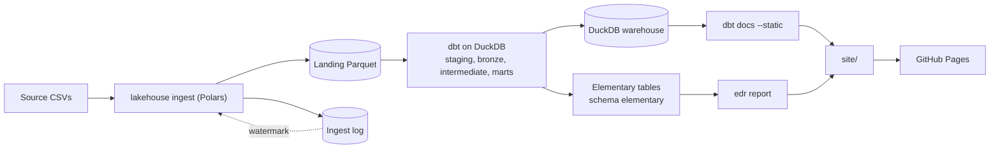

# Architecture

A short tour of how the pieces fit. The README has the commands, [IMPLEMENTATION_PLAN.md](IMPLEMENTATION_PLAN.md) has the design contract and [DECISIONS.md](DECISIONS.md) has the reasons behind each choice.

## Layers and contracts

- Source: nine CSVs with the Olist file and column names, from a deterministic generator or the Kaggle download.
- Landing: one typed Parquet set per table. Rows that break the contract go to a rejects Parquet with a reason; a table whose reject ratio is too high fails the run. Every row carries `_batch_id`, `_extracted_at` and `_source_file`.
- Ingest log: one row per table and run, with row counts (`rows_in = rows_out + rows_rejected`) and the watermark. A dbt test reconciles landing against it.
- Staging: views that rename and clean, one per landing table.
- Bronze: one deterministic row per natural key. No wall-clock columns, every tie-break has a total order, so a re-run gives identical data.
- Intermediate: joins at a declared grain.
- Marts: a star schema with enforced contracts and a description on every column.

## One writer

Python never writes DuckDB; it reads it only through short read-only connections. dbt is the only writer, and it reads the landing Parquet directly. The same rule drives the Airflow setup: every Cosmos task runs a dbt process, so all of them use the one-slot pool `duckdb_writer`.

## Change data capture

Olist has no update column, so landing derives `order_updated_at` and uses it as the watermark. The watermark lives only in the ingest log. An incremental ingest lands the rows past it as a batch file, and `bronze_orders` merges them (`delete+insert` on `order_id`). Hard deletes and changes that set no lifecycle timestamp are not captured (see the README for the limits).

## Orchestration

An hourly Airflow DAG runs three bash tasks (source, CDC simulation, incremental ingest) and then the dbt project as a Cosmos task group, one task per model and test, in a local docker compose stack.

## Observability

The Elementary dbt package writes its models and test results to the schema `elementary` in the same DuckDB file. Bronze tables get `schema_changes` (error) and `bronze_orders` gets `volume_anomalies` (warn). `make site` reads that schema with the edr CLI to render the report, next to the static dbt docs and a landing page.

## CI/CD

GitHub Actions runs lint, the fast tests with a coverage gate, the full pipeline and the slow end-to-end test, the DAG integrity test, and the site build. A separate workflow smoke-tests the compose stack, and a security workflow audits dependencies. The `site` job uploads the Pages artifact; the `deploy-pages` job publishes it on pushes to main only.
